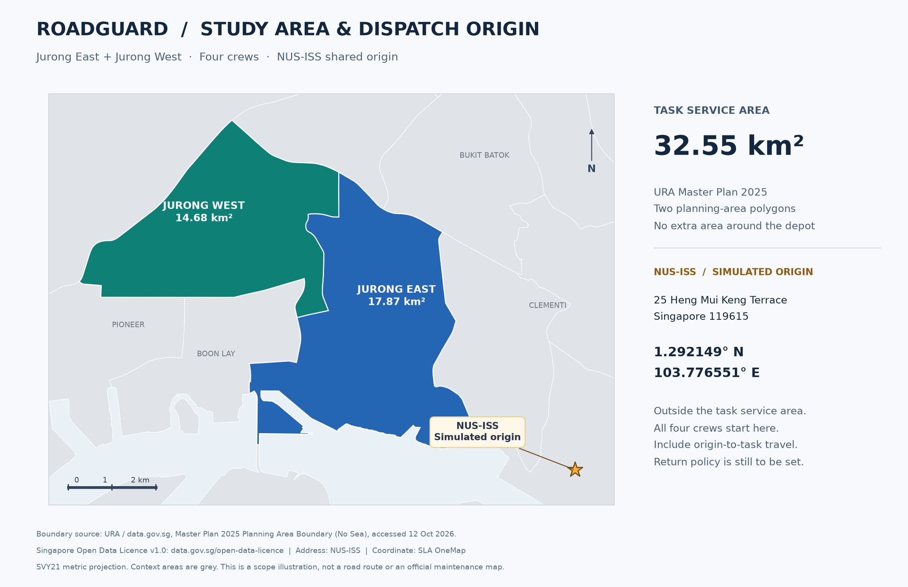

# RoadGuard Jurong scope and NUS-ISS simulated dispatch origin

Version: 1.0 · Date: 2026-10-12 · Business owner: A (project initiator).

The first version restricts repair tasks to **Jurong East and Jurong West planning areas**, with four crews departing from **NUS-ISS**. NUS-ISS is outside the task area, requiring separate treatment of task eligibility, depot and driving paths: tasks inside, designated depot outside, routes allowed across boundaries.

This retains Step 1 scope design/static checks. [Step 6](INSPECTION_REVIEW_TASK_WORKFLOW.md) later implemented task-point polygon validation and inspection/task storage. Road type remains user-declared without network checks. NUS-ISS is a user-selected real place, but dispatch, crews, department and tasks are course simulations, not actual university maintenance or endorsement.

## 1. Initial scope decisions

| Item | Agreement |
| --- | --- |
| Task service area | Union of URA Master Plan 2025 JURONG EAST/JURONG WEST polygons |
| Area | Approximately **32.55 km²**, including all land uses, not repairable road area |
| Origin | **NUS-ISS, 25 Heng Mui Keng Terrace, Singapore 119615** |
| Coordinates | Latitude 1.292149, longitude 103.776551, WGS84 |
| Crews | crew-01, crew-02, crew-03, crew-04, shared origin |
| Assignment | All crews serve the whole area, no East/West preallocation |
| Tasks | Simulated damage repair on ordinary public motor roads |
| Main experiments | 10/15/20 tasks, excluding depot |
| Outbound travel | Count NUS-ISS to each working crew's first task |
| Return | Pending scheduling decision; null in example |

Adjacent planning areas give “Jurong” a checkable/reproducible boundary with room for cross-area assignment/ordering. This project choice excludes the broader colloquial Jurong; an outside depot does not expand task scope.



Colored areas are eligible geography, star NUS-ISS, gray neighboring areas. The depot annotation is not a route. Sources in section 9.

## 2. Geographic boundaries

### 2.1 Included and excluded

| Official area | Code | Source area | Use |
| --- | --- | --- | --- |
| JURONG EAST | JE | 17.8695 km² | Eligible road tasks |
| JURONG WEST | JW | 14.6804 km² | Eligible road tasks |
| Total | — | 32.5499 km² | Rounded to 32.55 km² |

**BOON LAY, PIONEER, TUAS, BUKIT BATOK, CLEMENTI, QUEENSTOWN and other areas are excluded.** Road/station/building names containing Boon Lay/Pioneer/Jurong do not replace coordinate validation; names do not map one-to-one to planning areas.

Only ordinary public motor roads qualify. Exclude expressway mainlines/ramps, private/restricted internal roads, car parks/campus roads, footpaths/cycleways/lakes/non-motor park roads and unopened planned roads. These are project decisions; planning polygons contain neither road types nor vehicle permissions.

### 2.2 Sole boundary dataset

| Field | Value |
| --- | --- |
| scope_version | jurong-je-jw-mp2025-v1 |
| Dataset | URA Master Plan 2025 Planning Area Boundary (No Sea) |
| ID | d_2cc750190544007400b2cfd5d7f53209 |
| Period/catalog update | 2025-12 / 2026-02-27 |
| Acquired | 2026-10-12 |
| Filter | PLN_AREA_N equals JURONG EAST or JURONG WEST |
| Local file | [jurong-boundary-mp2025.geojson](geography/jurong-boundary-mp2025.geojson) |
| Contents | Two original Features, all properties/coordinates, no simplification |
| Coordinates | WGS84 decimal degrees; GeoJSON [longitude, latitude] |

Task validation uses polygon union with **covers** semantics: interior/edge passes geography, but road/task requirements still apply. Inside is not automatically repairable.

Viewport bounding box [west,south,east,north]:

```text
[103.674932, 1.296503, 103.757281, 1.364348]
```

This locates the view only. Rectangle checks would admit outside points; this box also excludes NUS-ISS and cannot alone define the final viewport.

All three use the same frozen file, not independent latest downloads. A synchronizes version/configuration/examples/affected experiments for future updates. URA describes indicative planning boundaries; do not interpret these as statutory repair jurisdiction.

## 3. NUS-ISS simulated depot

| Field | Value |
| --- | --- |
| depot_id | depot-nus-iss |
| depot_version | nus-iss-v1 |
| Display | NUS-ISS (simulated dispatch origin) |
| Address | 25 Heng Mui Keng Terrace, Singapore 119615 |
| latitude | 1.292149 |
| longitude | 103.776551 |
| GeoJSON Point | [103.776551, 1.292149] |
| Planning area | QUEENSTOWN, checked against this URA source |
| Inside task area | No, explicit designated-depot exception |
| File | [nus-iss-depot.geojson](geography/nus-iss-depot.geojson) |

Address from [NUS-ISS directions](https://www.iss.nus.edu.sg/about-us/getting-to-nus-iss); SLA OneMap exact-address match NATIONAL UNIVERSITY OF SINGAPORE (INSTITUTE OF SYSTEM SCIENCE), latitude 1.292148512297166/longitude 103.776550885502, rounded to six decimals. Results/sources: [sources.json](geography/sources.json).

This is a **building reference, not a verified drivable entrance**. B checks road access on travel integration. If an entrance point is needed, A/B record evidence and update depot version/configuration/map. GA/Greedy share coordinates; do not silently use different snapped points.

Four crews at one depot do not create four geographic origins. Return policy/shifts/common start are later scheduling decisions.

## 4. Validation and travel

| Object | Rule | Example |
| --- | --- | --- |
| Task | Covered by JE/JW and road-eligible | Outside tasks excluded from valid inputs |
| Fixed depot | depot-nus-iss allowed outside | NUS-ISS not rejected by applying task restrictions |
| Other depot | No automatic exception | Adding/moving is a scope change |
| Route | Legal drivable roads may leave area | NUS-ISS travel not clipped to polygons |
| Expressway | No mainline/ramp repairs initially; permitted commuting allowed | Excluding repairs does not exclude driving |

A owns task geography; B depot configuration/reachability/travel; C shows boundary/depot/routes. Do not apply task restrictions to depot or treat polygons as road network.

Label simulated tasks. RDD2022ES photos and Jurong coordinates are different sources; demos must not claim photos were captured there. Future fixed sets should use verifiable road points, not random polygon points presented as roads.

## 5. Four-crew planning and GA evaluation

N distinct tasks plus shared depot yield N+1 geographic nodes: 11/16/21 for 10/15/20 tasks. Retain four crew states/independent orders despite one origin. If coincident task coordinates are later allowed, retain distinct IDs and explain matrix-node deduplication.

B's directional matrix covers depot/task travel:

1. Each working crew starts at NUS-ISS; count first travel in totals, arrival and shifts.
2. Return remains unresolved; if required, count final task-to-depot; otherwise define completion explicitly. null is undecided, not false.
3. GA/Greedy share tasks/depot/matrix/start/return policy.
4. Unreachable/API failure is not zero; label/store real versus simulated provenance.
5. Do not invent commute minutes or substitute straight-line distance for road time before actual data.

Smaller geography controls demo/collection work, but **GA runtime does not necessarily decrease with area or more crews**. Task count, encoding, population, iterations and constraints determine search size. Measure operations/runtime/API use separately without premature cost/performance claims.

## 6. Three-person integration and configuration

| Owner | Materials here | Later behavior | Handoff |
| --- | --- | --- | --- |
| A: vision/rules | Scope/boundary/depot/example config | Task checks, verified road examples, mock labeling, scope coordination | B valid Tasks/versioned config; C scope/errors |
| B: dispatch | Shared depot/coordinates/four IDs/exception | Vehicle access/reachability, first travel, return/shift proposal, matrix/nodes | A unreachable feedback; C depot/order/source |
| C: UI/assistant | Boundary/depot GeoJSON, map/copy | View Jurong/NUS-ISS together, distinguish depot/tasks, label simulated origin, explain outside start | Use A scope/B facts; no second rules |

[project.example.json](../SystemCode/config/project.example.json) expresses this design. geojson_path is relative to **repository root**, not configuration directory; A's shared loader resolves it, A/C agree frontend delivery during API design.

Shared backend now reads configuration at startup; Step 6 checks frozen version/paths. study_boundary describes scope; allowed_outside_task_service_area applies only to the specified depot; routes_may_leave_study_area is future routing; return_to_depot:null retains pending decision. Reading fields does not implement a planner.

## 7. Checks in this round

| Check | Result/meaning |
| --- | --- |
| Selection | JE/JW two of 55 source Features, unchanged properties/coordinates |
| Geometry | Both Polygons/union valid; unsimplified |
| Area | Source total 32.549893 km²; EPSG:3414 SVY21 recalculation agrees at display precision |
| Depot | Outside JE/JW, inside source QUEENSTOWN |
| Provenance | Original/extracted boundary and depot SHA-256 in sources.json |
| Access/travel | B-5 on 2026-10-15 added optional Google Routes (off by default); three-task smoke test found depot round trips reachable, 19–24 minutes. Preliminary, not formal entrance validation |

These static checks do not establish implementation of task validation, planner or map UI.

## 8. Open work after this step

This completes the Jurong/depot substep, **not all M0**. A coordinates fields/labels/rules/confidence/duration/deadlines; B proposes shifts/return/metrics/constraints; C checks map/form fields. Agree examples before implementation.

B verifies vehicle entry during travel integration. Do not call the building point verified beforehand. This round creates no task generator/backend API/frontend map/GA business code.

## 9. Sources and usage

- **Boundary/area**: [URA/data.gov.sg Master Plan 2025 Planning Area Boundary (No Sea)](https://data.gov.sg/datasets/d_2cc750190544007400b2cfd5d7f53209/view), acquired 2026-10-12. Project GeoJSON is JE/JW subset; map derived.
- **License**: URA data under [Singapore Open Data Licence v1.0](https://data.gov.sg/open-data-licence); retain source/date/license on distribution, no endorsement implication.
- **Address**: [NUS-ISS directions](https://www.iss.nus.edu.sg/about-us/getting-to-nus-iss), checked 2026-10-12.
- **Coordinates**: [SLA OneMap](https://www.onemap.gov.sg/api/common/elastic/search?searchVal=25%20HENG%20MUI%20KENG%20TERRACE&returnGeom=Y&getAddrDetails=Y&pageNum=1), checked 2026-10-12; exact match in [sources.json](geography/sources.json).

Road restrictions, shared depot, outside exception and travel accounting are project decisions, not business rules from those publishers.
