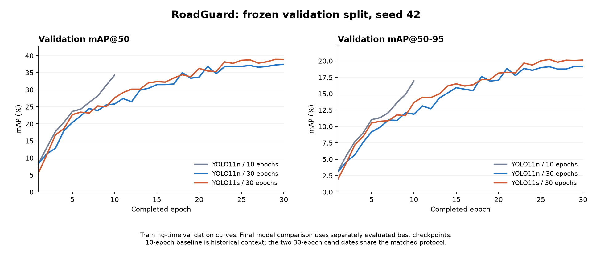

# YOLO11n / YOLO11s 30 轮对比与主管验收

日期：2026-10-13；负责人 A。按授权先分析 10 轮模型的验证错误，再让 YOLO11n、YOLO11s 各独立训练 30 轮。GPT-6.1-sol 子 agent 开发分析、比较和测速工具；主 agent 复核实现、查看错误样本，并执行训练、独立验证、完整性检查和真实 HTTP 验收。

本轮按预注册的 validation mAP50-95 规则选出 **YOLO11s 30 轮**，它比同轮数 n 模型高 **1.07 个百分点**，mAP@50 高 **1.50 个百分点**。改进幅度有限：在固定置信度 0.25 下，s 检出的目标更多、误报也更多，并且 CPU 更慢。选型通过不等于业务准确率达标；仍保持 experimental，所有非空真实检测必须先审核。

## 1. 同一口径下的结果

下表全部使用同一组 **1,921 张验证原图、2,623 个标注框、8 类**，评估各运行的 best.pt。

| 模型 | 验证 mAP@50 | 验证 mAP@50–95 | 库报告 P | 库报告 R | 训练日志最佳轮次 | 训练日志耗时 |
| --- | --- | --- | --- | --- | --- | --- |
| YOLO11n · 10 轮历史基线 | 34.28% | 16.93% | 35.04% | 42.94% | 10 | 8.28 分钟 |
| YOLO11n · 30 轮 | 37.27% | 19.16% | 38.26% | 40.74% | 29 | 23.76 分钟 |
| YOLO11s · 30 轮 | 38.77% | 20.23% | 40.62% | 43.48% | 26 | 35.00 分钟 |

此前提到的 **36.19% 是 10 轮基线的 test mAP@50**，不能和本表 validation 数值直接作提升比较。本轮未打开或推理候选模型的 test 图片和标注，也未通过 test 选择模型、阈值或训练参数。旧基线的 test 已被查看，不能再称为从未观察过的独立新测试集。

库报告 P/R 是验证 PR 曲线所选工作点的类别均值，不是下节 conf=0.25 的计数比例。mAP 统计一系列置信度下的检出与定位表现；mAP@50 的 50 指框匹配 IoU=0.50，和置信度 0.25 是两个参数。训练日志耗时不包含后续独立评估、错误分析、CPU 测速和 HTTP 验收。



逐类 validation mAP@50：

| ID / 源标签 | 验证标注框 | n · 10 轮 | n · 30 轮 | s · 30 轮 |
| --- | --- | --- | --- | --- |
| 0: longitudinal crack | 941 | 54.93% | 56.85% | 60.63% |
| 1: longitudinal crack wide | 148 | 29.63% | 34.88% | 34.28% |
| 2: transverse crack | 541 | 44.67% | 48.79% | 48.60% |
| 3: transverse crack wide | 46 | 17.67% | 14.36% | 18.16% |
| 4: alligator crack | 526 | 50.66% | 53.36% | 53.48% |
| 5: alligator crack sunken | 77 | 23.36% | 28.39% | 33.79% |
| 6: pothole | 299 | 26.74% | 29.31% | 30.80% |
| 7: pothole deep | 45 | 26.57% | 32.25% | 30.40% |

s 并未在每类都获胜：wide longitudinal、transverse 和 deep pothole 的 mAP@50 略低于 n30。少数类仅有 45～77 个验证框，单次结果不稳定；不能从总体均值推断深坑或宽裂缝已识别可靠。

## 2. 先分析错误，再解释优化效果

三个模型使用同一 1,921 张验证原图进行单图 GPU 推理，conf=0.25、NMS IoU=0.7、imgsz=640、max_det=100、FP32。按同类、置信度顺序、一对一 IoU≥0.5 匹配；下表为全类别汇总的 micro 计数，和官方 mAP/P/R 计算不同。后端实际使用 CPU，GPU 诊断与 CPU 核函数可能有微小差异。

**置信度 0.25 的用途**：模型为每个候选检测框输出分数；阈值 0.25 会过滤评分低于该值的框。0.18 通常被过滤，0.60 通常被保留，后续还经过 NMS 等处理。这个分数没有经过概率校准，不能读成“该框有 25% 的正确概率”，也不是“整个模型准确率 25%”。阈值提高通常减少误报，也会增加漏检；本轮没有调整这个阈值。

| 模型 | TP：正确匹配 | FP：未匹配预测 | FN：未检出标注 | 固定阈值 precision | 固定阈值 recall |
| --- | --- | --- | --- | --- | --- |
| YOLO11n · 10 轮历史基线 | 1080 | 978 | 1543 | 52.48% | 41.17% |
| YOLO11n · 30 轮 | 1236 | 1199 | 1387 | 50.76% | 47.12% |
| YOLO11s · 30 轮 | 1343 | 1419 | 1280 | 48.62% | 51.20% |

与 n30 相比，s30 少漏 **107** 个标注，但多出 **220** 个未匹配预测；与 n10 相比少漏 **263** 个、多出 **441** 个未匹配预测。因此不能概括为“换 s 后误报也更少”。在 conf=0.25 下 s 的 precision 为 48.62%，必须继续依赖审核。

主 agent 分别查看三个模型各 40 个分层错误样本的联系表，共 120 个样本展示（不同模型间可重复），并单独查看基线的三个案例：

| 固定案例 | 基线 → n30 → s30：TP / FP / FN | 观察 |
| --- | --- | --- |
| India_001650 | 0/0/2 → 0/2/2 → 0/0/2 | 低对比度细裂缝仍漏检；单纯增加模型没有解决该例 |
| Japan_003097 | 0/1/1 → 0/1/1 → 0/1/1 | 同一裂缝的普通/宽类别混淆仍存在 |
| Japan_005511 | 1/3/5 → 2/3/4 → 3/5/3 | 重叠裂缝场景找回更多目标，同时出现更多误报 |

s30 的 FP 诊断分为 background 690、localization 358、confusion 266、duplicate 105；FN 分为 missed 894、localization 227、confusion 159。它们是相对于现有标注的诊断规则，不是经专家确认的原因。例如空标注图上的预测可能提示标注问题，但不能据此断言标注错误。未修改标签，也未把视觉 wide/deep/sunken 当作实际宽度、深度或维修等级测量。

## 3. 实验如何保证可比较

冻结协议见 [COMPARISON30.md](../SystemCode/model/COMPARISON30.md)，可审计配置见 [compare30_plan.json](../SystemCode/experiments/vision/compare30_plan.json)。训练代码先提交到 `7cfd6ae82597fddb7a608df632a792df83176668`，两个训练都记录 git_dirty=false，核心来源文件哈希和运行环境一致。

- 两组各从官方 COCO 的 yolo11n.pt / yolo11s.pt 独立初始化，不从 10 轮结果续训；固定 seed 42，均完成连续 30 轮，无 OOM 降 batch，无中途恢复。
- imgsz=640、batch=32、workers=4、device=0、deterministic=true、amp=false、cache=false、fliplr=0；AdamW、lr0=0.001、lrf=0.01、warmup_epochs=1、close_mosaic=2、patience=30。nbs=64，名义梯度累积 2；warmup 期间累积由库调整。
- 训练含 17,916 张图（8,958 张原图及对应镜像）；验证只含原图。主 agent 对 train/val 的 39,674 个图片及标签文件重新核对 SHA-256，框计数一致；检查三个 split 的分组元数据无交叉。
- 准备阶段按镜像、完全重复及保守近似重复分组；保留隔离项记录。该分组不证明相邻帧或同一摄影场景完全独立。
- RTX 5090 32 GB；Python 3.12.14、torch 2.10.0+cu128、torchvision 0.25.0+cu128、Ultralytics 8.4.176。评估使用库原生指标，未声称运行可选的 faster-coco-eval。
- 预注册排序为 validation mAP50-95、mAP50，只有两项精确相同时才由匹配 CPU 测速决胜。本轮无需延迟决胜。

只有一个训练种子，不能估计训练方差或宣称统计显著优势。10 轮历史模型只作背景；其总 epoch 不同会改变学习率调度进度，n10→n30 的变化不能纯粹归因于“多训练 20 轮”。本轮公平的架构比较是 n30 与 s30。

## 4. 实际 CPU 耗时

AMD Ryzen 7 9800X3D；CPU FP32，intra-op 4 线程、inter-op 1。从四个国家各固定选 10 张验证原图，共 40 张；两组共用这些图片，每组预热 2 次，再测 3 遍，计 120 次。轮次顺序 n/s、s/n、n/s。

| 模型 | 融合前实际参数量 | 单图 median | 单图 p95 |
| --- | --- | --- | --- |
| n30 | 2,606,584 | 53.27 ms | 63.59 ms |
| s30 | 9,430,888 | 81.87 ms | 91.85 ms |

计时覆盖 `ImageStore.prepare(bytes)` 到 `LocalVisionDetector.detect()` 返回 DTO，包括校验、解码、图片规范化、模型前后处理和 CPU 推理。排除磁盘读取、权重冷启动、HTTP、数据库和规则/任务处理，不能称为完整 API 响应时间。40 张固定图片不是生产流量，OS 缓存、调度和温度仍可能影响测量。

首次测速 acceptance-v1 因当前 Ultralytics 不再提供 predictor.args.half 而在正式计时前失败；修复为检查 quantize、实际后端 fp16 和参数 CPU/float32，并增加测试。缓存目录创建顺序也已修正。失败记录保留，最终有效证据仅为 acceptance-v2；没有混用失败样本。

## 5. 主 agent 验收、保存点与清理

| 检查 | 实际结果 |
| --- | --- |
| 应用回归 | 692 passed，1 skipped；Windows 用户没有实际符号链接创建权限，该用例由 Linux CI 执行 |
| CI 守卫单元测试 | 44 passed；Windows 沙箱临时目录写权限限制下失败的尝试，经同代码在允许环境重跑通过 |
| 配对运行证据 | 30 个连续 epoch、实际 batch=32、共同参数和输入哈希、权重及验证报告一致 |
| 恢复权重 | n/s 的 latest=30 轮、previous=29 轮；均能读取，live/EMA 及 optimizer 张量有限，每份 optimizer 有 255 个状态项 |
| 真实 HTTP 验收 | 使用选中 s30，隔离 Uvicorn 服务实际通过 11 个响应案例 |
| 清理 | 已删除 train.cache 与 val.cache，共 4,797,603 bytes（约 4.8 MB）；未删除数据或权重 |

HTTP 检查包括真实上传先进入审核、上传幂等、证据图片获取、确认后建任务且只建一次、完成任务后活动快照清空及版本递增、重启持久化、禁用模型时已完成上传可重放且新真实上传返回 503。测试使用真实模型、验证图片与合成 Jurong 坐标，验证的是业务连接，不是图片拍摄地点或专家审批。没有使用端口 8000，也没有改动用户的 PyCharm 启动配置。

每组保留 `weights/best.pt`、`weights/last.pt`、`weights/resume-latest.pt` 和 `weights/resume-previous.pt`，以及恢复 JSON、配置和日志。best/last 用于推理；完整恢复状态在 resume 文件中。两组已完成 30 轮，不应用 resume 将本实验静默延长。末轮异常恢复需按 [训练指南](../SystemCode/model/TRAINING.md) 使用 previous 重放末轮。此次读取验证不等于重新做了一次中断恢复实验；第 8 步已记录的真实两轮中断恢复测试仍为该机制的运行证据。

## 6. 本地模型如何使用

选择出的清单（相对仓库根目录）：

```text
Dataset/runs/yolo11s-rdd2022es-compare30-seed42/model_manifest.json
```

可在 PyCharm 现有后端 Run Configuration 中把 `ROADGUARD_VISION_MANIFEST_PATH` 指向该清单，再由用户重启后端。详细要求见 [真实检测接口说明](REAL_VISION_API.md)。当前运行中的后端环境没有被自动替换；旧基线也保留。新机器拉取 Git 后不会获得这些本地权重，须按训练指南复现或通过另外约定的模型交付方式获取并校验。

选中 best.pt SHA-256：`92749da1b1c05f2186e388c9d0cee65cc868613662c5aa21d940d76ec003940a`。接口仍为 a-workflow-v2、a-task-query-v1、a-knowledge-v2；未修改业务契约和演示规则，B/C 无需为本次离线实验改接口。

## 7. 证据与复现入口

Git 只保存工具、测试、本文、[小型完整指标摘要](../SystemCode/experiments/vision/compare30_summary.json)、冻结计划和 [n30](../SystemCode/experiments/vision/compare30_n_results.csv) / [s30](../SystemCode/experiments/vision/compare30_s_results.csv) 训练曲线 CSV。摘要含数据、来源、权重、原始报告哈希及验收细节。Dataset/ 整体忽略；下载数据、模型、预测、标注图片、HTTP 数据库和完整日志均留本地。

本地完整证据位于：

```text
Dataset/compare30/{plan.json,summary.json,summary-with-latency.json,integrity.json}
Dataset/error-analysis/{baseline10-val-errors,compare30-n-val-errors,compare30-s-val-errors}/
Dataset/compare30/cpu-latency/acceptance-v2/latency.json
Dataset/compare30/http-acceptance/summary.json
Dataset/runs/yolo11{n,s}-rdd2022es-compare30-seed42/
```

已完成的实验不要原地覆盖。训练与比较的命令、未使用运行名和输入约束见 [配对实验协议](../SystemCode/model/COMPARISON30.md)；错误分析见 [ERROR_ANALYSIS.md](../SystemCode/model/ERROR_ANALYSIS.md)。例：

```powershell
.venv/Scripts/python.exe SystemCode/model/analyze_errors.py --weights Dataset/runs/yolo11s-rdd2022es-compare30-seed42/weights/best.pt --run-name new-s-val-errors --device 0
.venv/Scripts/python.exe SystemCode/model/benchmark_cpu.py --repo . --run-name new-cpu-check
.venv/Scripts/python.exe -m pytest SystemCode/tests -q
```

本轮验收范围已经完成。仍待另行安排的是业务阈值/审核负担的评估、少数类及疑似标注问题的定向核查、Jurong 实际场景泛化验证；没有擅自追加训练或改变阈值。本轮数据说明这些问题仍存在，不保证单靠延长训练就能解决。
