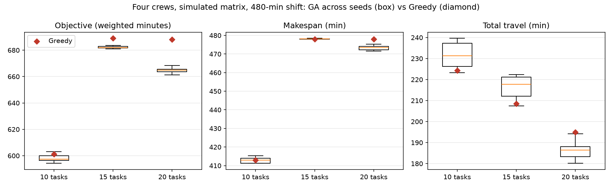
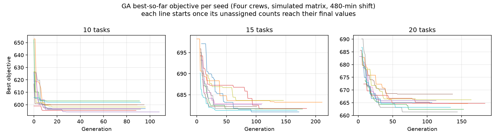
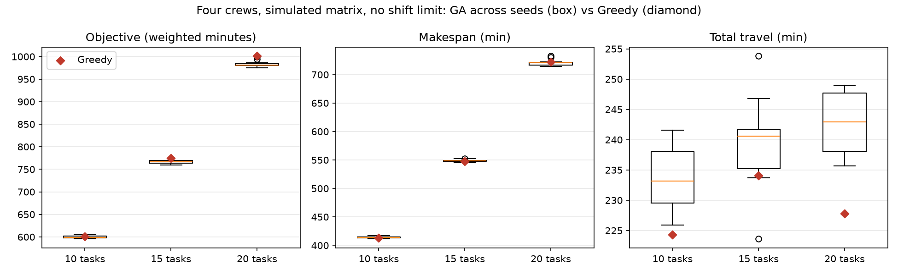
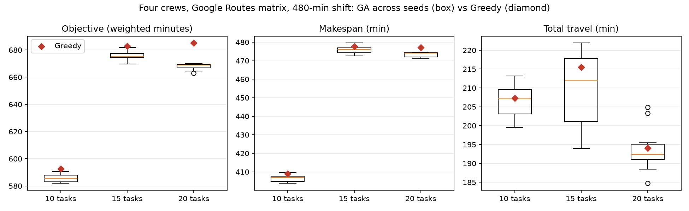
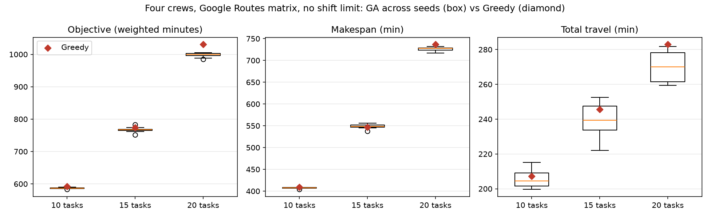

# B6 routing results: four-crew GA versus Greedy, simulated and Google matrices

Owner: B. Run date: 2026-10-15. Design: [parent guide](../README.md). All numbers below come from saved `summary.json` and `raw_runs.csv`, without manual alteration. Section 7 later evaluates GA itself through ablation/BKS gaps, with data in `ga-evaluation-v1/`.

## 1. Run records

| Item | `simulated-shift480-v1` | `simulated-unlimited-v1` |
| --- | --- | --- |
| Purpose | Main experiment: configured 480-minute shift | Sensitivity: remove shift limit, requiring all tasks on routes |
| Command | `run_experiments.py --output-dir .../simulated-shift480-v1` | Same, plus `--unlimited-shift` |
| Code | `7651947`, `working_tree_dirty=false` | Same |
| Override | None | `shift_limit=unlimited`, in metadata `settings_overrides` |
| Matrix | `simulated_haversine_v1`, no unreachable pairs; full `matrix_10/15/20.json` | Identical matrices |

Shared conditions: four available crews, NUS-ISS depot (`nus-iss-v1`), return to depot; `planning-synthetic-v2` 10/15/20 tasks; start `2026-10-15T01:00:00Z`. Deterministic Greedy runs once per scenario. GA uses seeds 1-10, population 60, at most 300 generations, patience 80, without Greedy initialization. Environment: Python 3.11.9, Windows, one machine.

Each directory contains `raw_runs.csv` (one row per run, including GA underperformance), `ga_convergence.csv` (generation best), `summary.json`, `run_metadata.json` (full configuration, hashes, code/environment), `matrix_*.json`, and `ga_vs_greedy.png`/`ga_convergence.png` from `plot_results.py`.

Reproduce by checking out `7651947`, running the table commands from repository root into a new directory. All metrics except runtime should match exactly.

## 2. Main experiment: 480-minute shifts

GA columns give ten-seed mean +/- population standard deviation; brackets give minimum/maximum. Units: minutes, except runtime in milliseconds.

| Metric | 10 tasks: Greedy | 10 tasks: GA | 15 tasks: Greedy | 15 tasks: GA | 20 tasks: Greedy | 20 tasks: GA |
| --- | --- | --- | --- | --- | --- | --- |
| Unassigned tasks (P1/P2/P3) | 0 | 0 | 3（0/2/1） | 3（0/2/1） | 8（0/6/2） | 8（0/6/2） |
| Total travel | 224.3 | 231.6 ± 5.8 [223.3, 239.6] | 208.5 | 216.2 ± 5.3 [207.5, 222.4] | 194.9 | 186.5 ± 4.3 [180.1, 194.2] |
| Makespan | 413.0 | 412.9 ± 1.6 | 477.9 | 478.1 ± 0.2 | 477.9 | 473.4 ± 1.3 |
| Workload standard deviation | 24.6 | 23.5 ± 1.2 | 23.6 | 24.9 ± 1.5 | 9.3 | 6.8 ± 1.1 |
| Priority-weighted completion | 262.0 | 254.7 ± 1.6 | 315.1 | 296.9 ± 1.5 | 333.2 | 301.1 ± 1.0 |
| Objective | 601.1 | 598.3 ± 2.7 [594.2, 603.0] | 688.9 | 682.2 ± 0.8 [680.9, 683.7] | 688.2 | 664.7 ± 1.9 [661.4, 668.4] |
| GA seeds better/equal/worse than Greedy | — | 8 / 0 / 2 | — | 10 / 0 / 0 | — | 10 / 0 / 0 |
| Algorithm runtime (ms) | 0.2 | 117 ± 11 | 0.1 | 233 ± 55 | 0.2 | 321 ± 62 |
| GA stopping generation | — | 88～108 | — | 101～211 | — | 107～184 |

## 3. Sensitivity: unlimited shifts

| Metric | 10 tasks: Greedy | 10 tasks: GA | 15 tasks: Greedy | 15 tasks: GA | 20 tasks: Greedy | 20 tasks: GA |
| --- | --- | --- | --- | --- | --- | --- |
| Unassigned tasks | 0 | 0 | 0 | 0 | 0 | 0 |
| Total travel | 224.3 | 233.5 ± 5.1 | 234.1 | 239.5 ± 7.7 | 227.8 | 242.6 ± 5.0 |
| Makespan | 413.0 | 414.1 ± 2.0 | 547.3 | 548.6 ± 2.2 | 722.1 | 721.1 ± 5.9 |
| Workload standard deviation | 24.6 | 23.9 ± 1.2 | 9.9 | 6.7 ± 2.3 | 27.8 | 25.8 ± 3.6 |
| Priority-weighted completion | 262.0 | 254.5 ± 1.3 | 351.8 | 332.6 ± 2.7 | 438.9 | 402.2 ± 4.2 |
| Objective | 601.1 | 600.0 ± 3.0 [595.3, 604.5] | 775.0 | 766.2 ± 3.5 [759.6, 770.1] | 1001.0 | 983.6 ± 7.6 [974.9, 999.9] |
| GA seeds better/equal/worse than Greedy | — | 6 / 0 / 4 | — | 10 / 0 / 0 | — | 10 / 0 / 0 |
| Algorithm runtime (ms) | 0.2 | 113 ± 17 | 0.2 | 150 ± 19 | 0.2 | 205 ± 39 |

## 4. Conclusions within these conditions

1. **Shift capacity is the main bottleneck at 15/20 tasks.** At 480 minutes, both algorithms leave identical tasks unassigned (3 at 15, 8 at 20), all `exceeds_shift_limit`, retaining every P1. Unlimited 20-task makespan is about 722 minutes. Four crews cannot finish these 20 tasks in one shift; scheduling alone cannot solve that.
2. **GA objectives beat Greedy for all seeds at 15/20 tasks, but only slightly at 10** (8/10 main, 6/10 sensitivity). Mean differences about 1-3 are comparable to seed variation.
3. **GA mainly improves priority-weighted completion**, finishing urgent tasks earlier by about 7-37 minutes, increasing with task count. Makespans are similar.
4. **GA does not improve every metric.** Except main 20-task input, mean travel is 5-15 minutes longer. This reflects weights 0.2 for travel versus 0.5 for priority-weighted completion. Workload standard deviation rises or falls without a consistent direction.
5. **Runtime**: GA about 0.1-0.4 seconds, Greedy under 1 ms. Both are fast enough for four crews/20 tasks. Local wall-clock algorithm time excludes separately recorded simulated-matrix preparation.

## 5. Limitations

- Sections 1-4 use simulated travel (straight-line distance x1.3 /30 km/h), not actual road times or evidence of real time/cost savings. Google results in section 6 have limitations too.
- One fixed synthetic task set only (10/15 prefixes of 20), with polygon-validated but unverified work-road positions. Different distributions may change conclusions.
- All `due_at=null`; no lateness is reported. Priority-weighted completion is not lateness.
- 480-minute shifts, depot return, weights and GA parameters are B's demo assumptions pending A confirmation, without independent-data GA tuning.
- Better means the actual lexicographic `(unassigned P1, P2, P3, objective)` order. Ten seeds per scenario, without statistical significance tests.

## 6. Google matrix experiments

Ran on 2026-10-15 at clean code `06cb76b`; versus `7651947` only results/docs were added, with identical code. Section 1 settings remain, replacing travel with Google Routes `computeRouteMatrix`, driving/`TRAFFIC_UNAWARE` without live traffic.

| Item | `google-shift480-v1` | `google-unlimited-v1` |
| --- | --- | --- |
| Command | `run_experiments.py --matrix-provider google_routes --output-dir ...` | Same plus `--unlimited-shift` |
| Google requests | One 21x21=441-element request; slice 10/15 matrices (`matrix_source=sliced_from_20`) | Separate identical-size request, 441 elements |
| API waiting | 412 ms (`matrix_preparation_ms`, excluded from algorithm time) | 150 ms |
| Unreachable pairs | 0 | 0 |

Both requests returned identical 20-task matrices; 882 elements were billed total.

### 6.1 Google versus simulated travel

Directly computed from two `matrix_20.json` files, 420 directed pairs:

- Median Google/simulated ratio 1.32, range 0.47-6.92. Short Jurong trips are generally longer with Google; long depot trips to distant tasks via expressways are shorter.
- Depot first legs: Google 9.8-23.4 minutes; simulation 6.4-31.3.
- Google is asymmetric: opposite directions differ by 2.0 minutes on average, maximum 7.5. Simulated matrices are symmetric.

### 6.2 Results: 480-minute shifts

| Metric | 10 tasks: Greedy | 10 tasks: GA | 15 tasks: Greedy | 15 tasks: GA | 20 tasks: Greedy | 20 tasks: GA |
| --- | --- | --- | --- | --- | --- | --- |
| Unassigned tasks (P1/P2/P3) | 0 | 0 | **2（0/2/0）** | **5 seeds: 2 (0/2/0), 5 seeds: 3 (0/2/1)** | 8（0/6/2） | 8（0/6/2） |
| Total travel | 207.3 | 206.5 ± 4.1 | 215.5 | 209.4 ± 9.5 | 194.1 | 193.8 ± 5.9 |
| Makespan | 409.0 | 406.6 ± 1.9 | 477.6 | 475.9 ± 2.0 | 477.1 | 473.3 ± 1.4 |
| Workload standard deviation | 24.6 | 23.3 ± 1.3 | 3.6 | 15.3 ± 11.9 | 6.4 | 4.5 ± 1.2 |
| Priority-weighted completion | 259.8 | 252.3 ± 0.6 | 320.7 | 301.0 ± 3.7 | 331.9 | 306.8 ± 1.7 |
| Objective | 592.6 | 585.7 ± 2.8 | 682.9 | 675.9 ± 3.3 | 685.1 | 667.7 ± 2.3 |
| GA seeds better/equal/worse than Greedy | — | 10 / 0 / 0 | — | **5 / 0 / 5** | — | 10 / 0 / 0 |
| Algorithm runtime (ms) | 0.2 | 119 ± 14 | 0.1 | 213 ± 24 | 0.1 | 283 ± 45 |

At 15 tasks, GA means mix 13-assignment and 12-assignment plans and cannot directly compare with Greedy. Use the better/equal/worse seed-count row.

### 6.3 Results: unlimited shifts

| Metric | 10 tasks: Greedy | 10 tasks: GA | 15 tasks: Greedy | 15 tasks: GA | 20 tasks: Greedy | 20 tasks: GA |
| --- | --- | --- | --- | --- | --- | --- |
| Total travel | 207.3 | 205.6 ± 5.0 | 245.7 | 239.6 ± 8.8 | 282.9 | 270.3 ± 8.6 |
| Makespan | 409.0 | 407.4 ± 1.4 | 546.5 | 548.3 ± 4.5 | 736.6 | 725.9 ± 4.5 |
| Workload standard deviation | 24.6 | 23.9 ± 1.3 | 3.7 | 6.7 ± 3.0 | 32.8 | 25.8 ± 2.8 |
| Priority-weighted completion | 259.8 | 252.5 ± 1.2 | 353.6 | 335.6 ± 3.0 | 441.6 | 409.8 ± 3.6 |
| Objective | 592.6 | 586.8 ± 1.8 | 774.3 | 767.3 ± 7.6 | 1030.4 | 997.7 ± 6.4 |
| GA seeds better/equal/worse than Greedy | — | 10 / 0 / 0 | — | 9 / 0 / 1 | — | 10 / 0 / 0 |

All tasks are assigned.

### 6.4 Google conclusions

1. **GA does not always beat Greedy.** Google/480/15 Greedy assigns 13 tasks (two P2 unassigned). Five of ten GA seeds assign 12, missing an extra P3 and losing lexicographically. For fair comparison, `seed_with_greedy=false`; after 80 generations without improvement, GA stops without capacity-optimal coverage. Every such run remains in `raw_runs.csv`.
2. **GA beats Greedy in 9-10 seeds in the other five scenarios.** Gains still mainly come from priority-weighted completion (7-32 minutes lower). Unlike simulation, Google GA mean travel is equal or shorter than Greedy.
3. **Source changes capacity conclusions.** At 15/480, Greedy misses three tasks with simulation but two with Google because expressways speed distant trips. Simulation alone underestimates daily capacity here.
4. **Runtime**: GA 0.1-0.4 seconds, Greedy under 1 ms. Google fetching takes 0.15-0.41 seconds, separately recorded outside algorithm runtime.
5. Section 6.6 diagnoses the first conclusion's failures.

### 6.5 Google limitations

- Single fetches with `TRAFFIC_UNAWARE`, not time-of-day travel distributions.
- Depot remains NUS-ISS building reference `nus-iss-v1`; entrance has preliminary checks only, without formal verification.
- Section 5 limitations for synthetic tasks, deadlines, demo assumptions and statistical tests also apply.

### 6.6 Failure diagnosis: Google, 480-minute shifts, 15 tasks

Reproduce: `python SystemCode/experiments/routing/diagnose_tight_capacity.py`. It reads `google-shift480-v1/matrix_15.json`, without Google calls or file writes. Numbers below come from its output.

| Observation | Data |
| --- | --- |
| Capacity | 15 tasks total 1920 service minutes, exactly 4x480; travel reduces maximum coverage to 13. Greedy assigns 13, leaving 2.4-11.3 minutes per crew. |
| Failed seeds (2,4,5,7,10) | Assign 12, missing one extra P3. Spare capacity concentrates in one crew (60.0-79.4), insufficient for 60-minute P3 plus depot legs; other crews retain 3.6-16.8 minutes. |
| Direct insertion | No feasible insertion at any crew/position for any of five failed seeds. |
| Two-step moves | Seeds 4,7,10 can relocate one assigned task to another crew then insert P3, reaching 13. Seeds 2,5 need more than two steps. |
| Lock-in | Failed seeds reach 12 assignments in generations 1-10, with no coverage improvement for over 100 more. |
| Larger budget | Patience 300/generations 1000 still fail seeds 2,4,5,7,10. |
| Other parameters | Population 120 fails seeds 1,3,10; mutation 0.6 fails 4,5,8,9. |
| Greedy initialization | All 10 seeds assign 13; objective 668.2-670.4, versus Greedy 682.9 and best pure GA 669.8. |

**Conclusion**: tight capacity with lexicographic objectives exposes a structural GA weakness. Extra coverage requires coordinated relocation+insertion; one-action mutation produces worse intermediate states eliminated by selection, causing premature convergence. More search budget/parameter changes did not solve it, so tuning was not pursued.

**Action**: online GA now starts from Greedy to guarantee no worse output. All experiments here remain independent pure-GA comparisons, with unchanged results. See [routing section 13](../../../backend/roadguard/routing/README.md). Relocation+insertion repair is an optional future improvement, not implemented.

## 7. GA evaluation: ablation and best-known gaps

Sections 2-6 ask whether GA beats Greedy. Online Greedy initialization guarantees a result no worse than Greedy (6.6), so a win/loss comparison alone is insufficient. Instead assess distance from the best findable plan, contributions of components, stability and computational cost.

### 7.1 Method

| Item | Content |
| --- | --- |
| Command | `python SystemCode/experiments/routing/evaluate_ga.py --output-dir SystemCode/experiments/routing/results/ga-evaluation-v1` |
| Code | `7bb1536`, `working_tree_dirty=false`; 2026-10-15T07:30Z, Python 3.11.9, Windows, one machine |
| Scenarios | Simulated/Google x 480-minute/unlimited x10/15/20 tasks =12. Read saved B6 `simulated-shift480-v1`/`google-shift480-v1` matrices, checking SHA-256/node order; no Google requests. |
| `greedy` | One baseline run per scenario |
| `ga_pure` | Default experimental GA, no Greedy initialization, seeds 1-10. Same as B6, reproducing sections 2/3/6 GA numbers. |
| `ga_seeded` | Default online GA with Greedy initialization, seeds 1-10 |
| `long_run` | Population 150, maximum 1000 generations, patience 300, seeds 101-120, alternating pure/Greedy-initialized GA; BKS search only. |
| Best-known solution (BKS) | Best of 41 runs per scenario: Greedy 1, pure GA 10, online GA 10, long_run 20, ordered by `(unassigned P1,P2,P3,objective)`. Routes in `best_known.json`. **Not a proven optimum.** |
| BKS gap | (objective - BKS objective) / BKS objective, only with equal assignment count. Fewer assignments are counted separately, never mixed into percentages. |

Outputs: `raw_runs.csv` (492 rows/runs), `summary.json`, `best_known.json`, `run_metadata.json`.

### 7.2 Results

Gaps are percent. GA gives ten-seed means with min/max brackets. Gap reduction = 1 - online-GA mean gap / Greedy gap.

| Scenario | BKS objective | Greedy gap | Pure GA gap | Pure GA fewer assignments | Online GA gap | Online GA beats Greedy | Gap reduction |
| --- | --- | --- | --- | --- | --- | --- | --- |
| Simulated / 480 / 10 | 594.2 | 1.17 | 0.68 [0.00, 1.48] | 0 | 0.43 [0.19, 0.97] | 10/10 | 63% |
| Simulated / 480 / 15 | 678.9 | 1.49 | 0.49 [0.31, 0.71] | 0 | 0.23 [0.19, 0.23] | 10/10 | 85% |
| Simulated / 480 / 20 | 659.9 | 4.29 | 0.73 [0.23, 1.29] | 0 | 1.07 [0.41, 2.08] | 10/10 | 75% |
| Simulated / Unlimited / 10 | 594.2 | 1.17 | 0.97 [0.19, 1.73] | 0 | 0.33 [0.00, 0.39] | 10/10 | 72% |
| Simulated / Unlimited / 15 | 759.6 | 2.02 | 0.87 [0.00, 1.39] | 0 | 0.75 [0.36, 0.79] | 10/10 | 63% |
| Simulated / Unlimited / 20 | 960.0 | 4.27 | 2.46 [1.55, 4.16] | 0 | 0.50 [0.00, 1.57] | 10/10 | 88% |
| Google / 480 / 10 | 580.5 | 2.09 | 0.89 [0.24, 1.72] | 0 | 0.67 [0.15, 0.93] | 10/10 | 68% |
| Google / 480 / 15 | 668.2 | 2.19 | 0.85 [0.24, 1.30](5 runs) | **5** | 0.23 [0.00, 0.32] | 10/10 | 89% |
| Google / 480 / 20 | 661.7 | 3.53 | 0.90 [0.17, 1.23] | 0 | 0.93 [0.38, 1.77] | 10/10 | 74% |
| Google / Unlimited / 10 | 580.5 | 2.09 | 1.08 [0.40, 1.57] | 0 | 0.57 [0.14, 0.93] | 10/10 | 73% |
| Google / Unlimited / 15 | 751.6 | 3.01 | 2.09 [0.00, 4.16] | 0 | 0.94 [0.92, 1.14] | 10/10 | 69% |
| Google / Unlimited / 20 | 980.4 | 5.10 | 1.77 [0.42, 2.55] | 0 | 1.82 [0.79, 2.69] | 10/10 | 64% |

- Greedy coverage equals BKS in every scenario, so all Greedy gaps are defined.
- BKS originates from long_run in seven scenarios, ga_pure in three and ga_seeded in two. Of 240 default-budget runs, five exactly reach BKS (pure three, online two).
- Objective standard deviation: online GA is lower in 8/12 scenarios, e.g. Google/unlimited/15 0.50 versus 7.62 and Google/480/15 0.56 versus 3.32. Four scenarios are slightly higher; three have 20 tasks (simulated/480/20 3.88 versus 1.89).
- Mean runtimes: pure GA 114-341 ms, online 105-362 ms, Greedy under 1 ms; long_run 0.7-5.4 seconds.

### 7.3 Conclusions within these conditions

1. **Greedy is 1.2%-5.1% from BKS, increasing with task count**: 1.2%-2.1% at ten tasks, 3.5%-5.1% at twenty.
2. **Online GA is 0.2%-1.8% from BKS, reducing Greedy's gap by 63%-89%.** All 120 runs beat Greedy without fewer assignments; mean objectives improve 0.7%-3.6% (`ga_seeded_improvement_over_greedy_percent`).
3. **Ablation: Greedy initialization mainly guarantees a floor, rather than improving every scenario.**
   - Online mean gaps are smaller in all eight 10/15-task scenarios; simulated/unlimited/20 also improves clearly (0.50% versus 2.46%).
   - Both 480-minute/20-task scenarios and Google/unlimited/20 tie or slightly favor pure GA (1.07% versus 0.73%, 0.93% versus 0.90%, 1.82% versus 1.77%). Earlier Greedy dominance reducing diversity is a possible, untested explanation.
   - Pure GA loses one P3 in 5/10 Google/480/15 runs (structural issue, 6.6); online never does. This is the main online rationale for Greedy initialization.
4. **Larger budgets yield little additional mean benefit.** long_run uses about ten times the budget and 0.7-5.4 seconds, but its 20-run mean is within +/-0.8% of online GA and worse in six scenarios (half its runs are pure GA). Its value is occasionally finding better plans to establish BKS. Defaults at 0.1-0.4 seconds are a reasonable online compromise.
5. **Small percentages partly reflect fixed objective components.** Makespan dominates and includes service time that algorithms cannot change. Absolute BKS gaps are about 1.5-18 weighted-cost minutes online versus 7-50 for Greedy. Component differences appear in sections 2/3/6.

### 7.4 Limitations

- BKS is merely best among 41 runs, without exact solver/lower-bound verification. Its gap is a **lower-bound estimate** of optimality gap; actual gaps may be larger.
- Evaluated pure/online methods themselves find BKS in some scenarios, giving one zero-gap run there.
- One fixed synthetic set (10/15 prefixes of 20) and two B6 matrices; no generalization validation on other random task sets.
- Ten seeds per method without significance testing; tiny section-7.3 differences such as 0.93% versus 0.90% cannot establish a real difference.
- Shifts, return policy, objective weights and GA parameters remain B's demo assumptions pending A confirmation.
