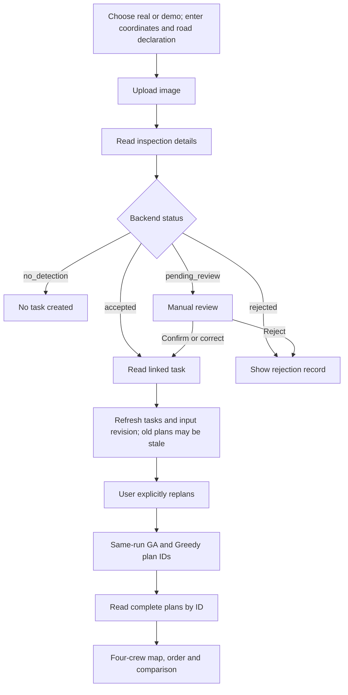
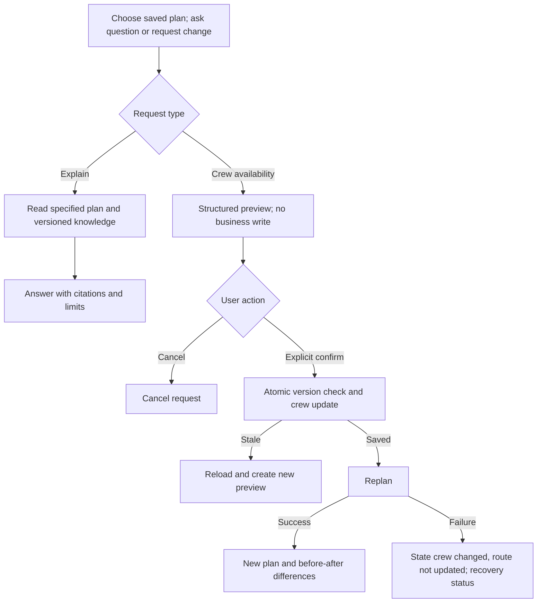

> Archive: retains the 2026-10-15 planning baseline/open work. Steps 1–9 are now implemented; README, VALIDATION.md and COMPARISON_GUIDE.md define actual acceptance. Steps 10–14 remain pending.

# RoadGuard · C step 1: Page flow

Baseline: local main `f8a2cf37de91c09d86ec14e6cbd6045e83e421f8`, 2026-10-15. This was design only: no pages, repository changes or runtime integration then. See API_MAPPING.md and OPEN_QUESTIONS.md.

## Six pages and entries

These were proposed frontend routes, not existing backend endpoints. Shared status shows connection, data source, plan ID/input revision and stale state.

| Page | Proposed path | User goal | Sources |
|---|---|---|---|
| Upload/results | /inspections/new, /inspections/:id | Photo/location/road declaration, one box and routing result | A01–A05/A09 |
| Review | /reviews | Confirm/correct/reject pending inspections | A03–A06/central labels |
| Tasks | /tasks, /tasks/:id | Details/rules/history, corrections/completion/cancellation | A07–A10/A04 |
| Four-crew routes | /routes | Stop order/unassigned reasons, availability, replanning | B01–B05/versioned geography |
| Comparison | /comparison | Same-run GA/Greedy | B03 paired IDs → B05 |
| Assistant | /assistant or route sidebar | Cited explanation, preview/confirm changes | C01–C04, all pending |

Suggested home was tasks. Missing plans must not block upload/review. Unconnected assistant shows unavailable, never invented answers. Health describes app/database only.

## Main flow

### P1 Upload/results

1. Explicit real/demo selection; demo chooses A01 scenario; real omits scenario_id entirely, including null.
2. JPEG/PNG ≤8 MiB/20 MP with WGS84 coordinates/public_motor_road declaration inside Jurong. Any frontend location feedback is provisional; backend decides. Declaration is not road-authority verification.
3. One idempotency key per logical upload. Disable duplicates; same photo/metadata retry reuses the key, changed content uses a new key.
4. A02 returns inspection_id/status/detection/task_id only. Read A04 immediately; retain successful ID on detail failure and retry reads rather than upload.
5. Use A05 normalised PNG and proportionally scaled bbox_xyxy/image_width/image_height. Details return at most one box; internal candidate IDs never become extra selectable boxes.
6. accepted/task_id → A09; pending_review → review; no_detection → no-task/new-upload; rejected → read-only history. No detection does not establish safety.
7. Show mode/model/rule versions and auto-acceptance/review provenance. is_demo alone cannot identify inference: real inspection/tasks still use demo business rules.

### P2 Review

Filter A03 pending_review with pagination; reopen via A04 for current record_version. Show normalised image, unique detection_id/label/confidence, rule/model provenance and central labels only. confirm sends detection_id; correct adds damage_label; dismiss omits both. Optional note ≤500 characters. A06 inspection/task is authoritative; refresh queue/tasks and flag replanning when planning_input_changed. A 409 requires fresh user assessment rather than replaying old intent. Processed records are read-only.

### P3 Tasks

A07 defaults active, supports completed/cancelled/all, counts/pagination. Pages are not complete planning input. Show label/severity/priority/repair minutes/deadline/status/version; null duration/deadline never zero. A09 provides recommendation/history; A04 decision_trace comes through inspection_id. Keep task history distinct from original detection decisions. Permit label/full-location correction or completed/cancelled, not priority/duration/deadline/free reopening. A10 carries record_version/request_id; success refreshes/warns stale. Use A08 for complete snapshots instead of mixing pages.

### P4 Routes and crew control

Read B01 crews and B04 latest selected algorithm; route_plan_not_found means no plan, not generic failure. Keep crew-01…crew-04 visible, distinguishing assigned/idle/unavailable and current availability from saved snapshots. Map includes frozen Jurong and external NUS-ISS with assigned/unassigned tasks. Follow stops.sequence without frontend optimisation. geometry=null allows labelled schematic lines only; Google times do not imply road polylines.

Separate travel/repair/total work. Arrival/completion offsets add to planning_start_at and display Singapore time. Return/shift follow saved settings with demo labels. B02 availability save does not mean routes updated; no-op may not increment input_revision. Explicit replanning B03 uses latest read/save revision, waits synchronously, retains paired IDs and reads B05. A calculation-time conflict requires refresh/new user action. Preserve old/stale plans after failure; no silent Google-to-simulation fallback. Timeout is uncertain and must not trigger automatic unlimited recalculation; there is no idempotent recalculation API.

### P5 Comparison

Prefer one B03 response’s paired IDs, provenance and matrix_generated_at, then B05. Compare assigned/unassigned P1/P2/P3, travel/makespan/workload/weighted completion/lateness/objective/runtime. Null is unavailable/not applicable; differences are GA−Greedy; zero baseline suppresses percentage. No universal-improvement or monetary claims. Show revision/start/settings/matrix source/simulation/parameters/seed; stale plans can be historical only. Independent latest reads lack matrix/run evidence; mark unverified and avoid fairness claims. Reliable cross-session pairing needs B batch IDs. Before/after-change comparison uses different inputs and cannot be attributed solely to algorithm quality.

### P6 Assistant (design; APIs absent)

Questions bind plan_id; comparison may add compare_plan_id. Cite saved fields and A-maintained knowledge; disclose inadequate evidence. Initially change only one crew’s available; clarify ambiguous crews. Closures, custom ordering and urgent-task insertion are excluded. Preview shows crew, before→after, plan/revision and possible recalculation without claiming a new route. Confirmation is separate: loading, questioning and preview never confirm. Duplicate confirm/cancel must return stable results. Atomic revisions, recalculation idempotency and recovery need A/B/C agreement before enabling assistant writes.

## Shared states

| State | Behaviour |
|---|---|
| Initial loading | Show loading, not zero tasks before a response |
| Empty success | Empty lists; no-plan entry; valid zero-task plans still show crews |
| Refresh failure | Retain data with failed-refresh/stale warning |
| 404 | Distinguish missing plan/record/image; offer back/read again |
| 409 | Separate record/input/idempotency conflict; no old-intent replay before check |
| 413/415/422 | Retain inputs and explain size/format/field/area errors |
| 502/503 | Explain inference/storage/matrix failure; no automatic demo/mock fallback |
| Write timeout | Uncertain outcome; same key for supported writes, no blind recalculation |
| Stale route | Viewable as history, never latest dispatch; offer replanning |

## Step 1 completion check

All six categories have entries/actions/sources/loading/empty/error rules. Implemented A/B and proposed C APIs are separate; static examples are not online records. Foundations/client/ordinary pages can proceed; assistant write/knowledge blockers remain explicit. Static verification does not establish running pages, passing integration or team approval of new APIs.
