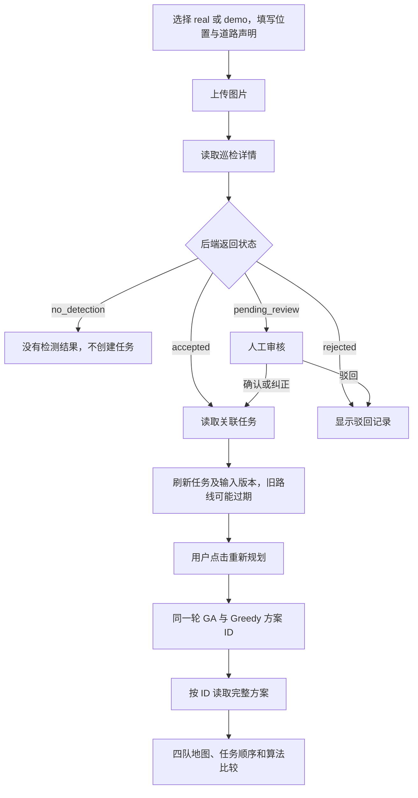
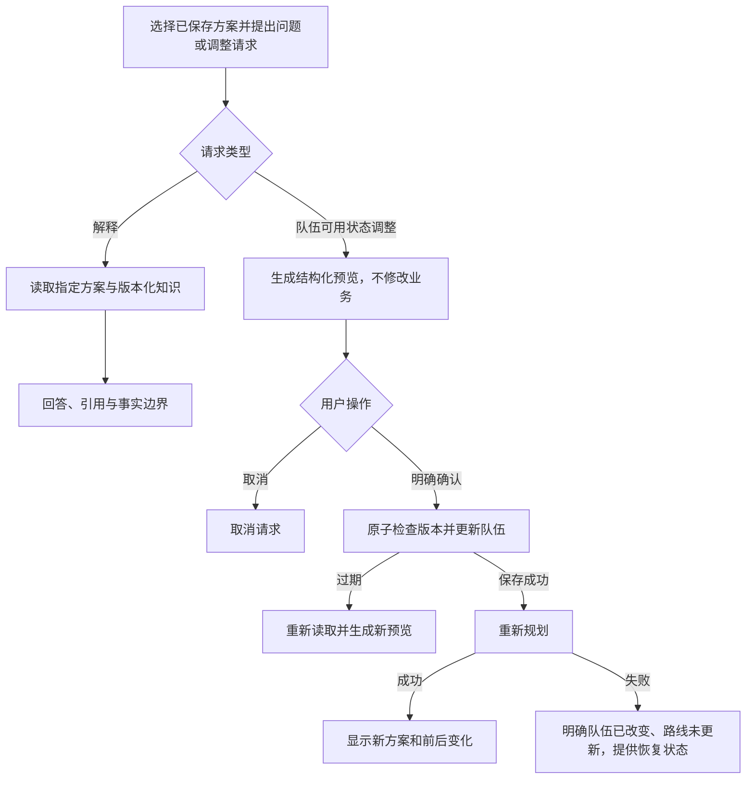

> 归档说明：下文保留 2026-10-15 规划时的基线与待办，不代表当前全部未实现。第 1–9 步现已实现，实际验证边界见前端 README、VALIDATION.md 和 COMPARISON_GUIDE.md；第 10–14 步尚待实施。

# RoadGuard · C 第 1 步：页面流程

基线：2026-10-15，本地 main `f8a2cf37de91c09d86ec14e6cbd6045e83e421f8`。本文件是 C 的实现设计；未开发页面、未修改仓库、未执行运行时联调。接口细节见同目录《接口对照表》，协作依赖见《待对齐事项》。

## 1. 六个页面与入口

以下是**建议的前端路由**，不是现有后端地址。全局显示连接状态、数据来源、当前方案 ID / 输入版本及“已过期”标记。

| 页面 | 建议地址 | 用户要完成的事 | 主要数据来源 |
|---|---|---|---|
| 上传与结果 | `/inspections/new`、`/inspections/:id` | 上传照片、声明位置与道路类型，查看唯一展示框和分流结果 | A01–A05、A09 |
| 人工审核 | `/reviews` | 确认、纠正标签或驳回待审巡检 | A03–A06；A 的中央标签文件 |
| 任务 | `/tasks`、`/tasks/:id` | 查看任务、规则来源、历史；修正位置/标签或完成/取消 | A07–A10、A04 |
| 四队路线与队伍控制 | `/routes` | 查看四队顺序和未分配原因，切换可用状态，重新规划 | B01–B05；版本化地理资料 |
| 算法比较 | `/comparison` | 比较同一轮 GA 与 Greedy | B03 返回的两个 ID → B05 |
| 助手 | `/assistant`（也可作为路线页侧栏） | 引用事实解释方案；预览、确认队伍状态调整 | C01–C04，全部待实现 |

首页建议进入任务页。没有方案不妨碍上传或审核；助手未接通时显示“尚未接入”，不伪造回答。健康接口仅代表应用/数据库状态。

## 2. 主流程

### P1 上传与结果

1. 用户选择 `real` 或明确标记的 `demo`。demo 从 A01 选案例；real 完全不提交 `scenario_id`，包括不传 null。
2. 选择 JPEG/PNG（最多 8 MiB、20 MP），填写 WGS84 纬经度与 `public_motor_road` 声明。位置必须属于 Jurong 服务范围；前端地图检查用于反馈，最终以后端为准。道路声明不是道路资质核验。
3. 一个上传动作生成一个幂等 key；正在上传禁用重复提交。失败重试同一图片和元数据时复用 key；修改内容时生成新 key。
4. A02 成功仅返回四字段：`inspection_id/status/detection/task_id`。立即 A04 读取详情；若详情失败，保留成功上传的 ID，只重试读取，不能重新上传。
5. 图片使用 A05 的规范化 PNG，框使用 `bbox_xyxy` 与对应 `image_width/image_height` 按比例缩放。详情最多返回一个框，不根据内部竞争 ID 生成多个可选框。
6. accepted 且有 task_id → A09 查看任务；pending_review → 审核入口；no_detection → 无任务提示和新上传入口；rejected → 只读历史。没有检测不等于道路安全。
7. 显示 `mode`、模型版本、规则版本和自动接受/人工审核来源。不要仅根据 `is_demo` 判断是否真实推理：当前真实巡检与任务仍属于演示业务规则。

### P2 审核

1. A03 筛选 `pending_review`，分页；进入记录后重新 A04 获取最新 `record_version`。
2. 展示规范化图片、唯一检测的 `detection_id/label/confidence`、规则记录和模型来源。标签选择只能来自中央标签定义。
3. 确认：发送 confirm + detection_id；纠正：correct + detection_id + damage_label；驳回：dismiss，不发送后两项。可附 500 字符以内 note。
4. A06 返回后以服务端 inspection/task 为准，刷新待审队列及任务；`planning_input_changed=true` 时提示路线需重算。
5. 遇到 409 记录版本冲突，刷新并让用户重新检查；不能自动把旧审核决定覆盖到新记录。已经处理的记录改为只读。

### P3 任务

1. A07 默认 active，支持 completed/cancelled/all；显示总数与分页。分页结果不能当作全量规划输入。
2. 表格展示标签、严重度、优先级、维修分钟、期限、状态、规则版本；未知时长/期限用“未提供”，不能显示为零。
3. 详情 A09 展示 `repair_recommendation/history`；规则决策链从任务的 `inspection_id` 再查 A04 的 `decision_trace`。任务历史与原始巡检决策分开展示。
4. 允许修正标签、完整位置三字段，或完成/取消；不允许编辑优先级、维修时间、期限或重新打开终态任务。
5. 写入 A10 携带 record_version/request_id；成功刷新并提示方案过期。需要全量活动任务时用 A08，而不是拼接不同时刻的分页。

### P4 四队路线与队伍控制

1. B01 获取四队；B04 取所选算法最新方案。404 `route_plan_not_found` 是“尚未生成方案”，不是服务器故障。
2. 总是保留 crew-01…crew-04 卡片。区分 assigned（有任务）、idle（可用但闲置）、unavailable（不可用）。当前队伍状态与旧方案中的队伍快照分开显示。
3. 地图显示 Jurong 边界、NUS-ISS 基地、已分配/未分配任务。基地可在服务区外；地图视野同时包含基地与服务区。
4. 路线严格按 stops.sequence 展示，不在前端排序或优化。geometry 当前为 null：只能画顺序示意线并明确标注“非实际道路路线”。即使使用 Google 行程时间，也不意味着取得道路折线。
5. 行程、维修、总工作时长分别展示；arrival/completion 是相对 planning_start_at 的分钟偏移，转换后以新加坡时间显示。返基地和班次按返回 settings 展示，并标记当前演示假设。
6. 切换队伍可用状态 → B02。成功只代表队伍保存；不显示“路线已更新”。无实际变化时 input_revision 不一定递增。
7. 单独点击“重新规划”，以最新读取/变更响应中的 input_revision 调 B03。等待同步返回；成功后保存本轮两个方案 ID，并 B05 取完整内容。计算中变化导致 409 时刷新版本，让用户再次发起。
8. 失败时保留旧方案并标记过期。Google 失败不得悄悄改用模拟。重算网络超时表示结果未知，不能自动无限重试；当前无重算幂等接口。

### P5 算法比较

1. 优先接收同一次 B03 的 GA/Greedy 两个 ID，再分别读取 B05。保存本轮回包的来源与 matrix_generated_at。
2. 表格列：已分配数、未分配数及 P1/P2/P3、行程分钟、完工分钟、工作量标准差、优先级加权完成分钟、延误分钟/任务数、objective_value、算法毫秒。
3. null 显示“不适用/未提供”；差值明确为 GA − Greedy。基准为零时不计算百分比；不宣称所有指标都改善，不折算为真实金额。
4. 展示 input_revision、planning_start_at、settings、matrix_provider、matrix_is_simulated、algorithm_parameters、random_seed。过期方案可作历史比较，但标出过期。
5. 独立读取两个 latest 不能证明同轮矩阵相同。缺少原重算配对记录时显示“同轮来源未核实”，不作公平实验结论；跨会话可靠配对待 B 补批次标识。
6. “调整前后比较”与“同输入算法比较”分开标注：前后输入不同，不能归因于算法优劣。

### P6 助手（设计，接口尚未存在）

- 问答必须绑定 plan_id；比较可加 compare_plan_id。来源包括已保存方案字段与 A 维护的知识片段。事实不足时明确无法回答。
- 首版建议一次只调整一支队伍的 available；队伍不明确先澄清。封路、改顺序、直接新增紧急任务等不在首版。
- 预览显示队伍名称、原值→目标值、基于哪个方案/输入版本、可能重算；预览不声称已有新路线。
- 确认必须是独立操作；生成预览、问答或页面加载不能触发确认。重复确认/取消要返回稳定业务结果。
- 原子版本检查、重算幂等和恢复状态尚需 A/B/C 对齐，解决前不接通有写入能力的助手。

## 3. 所有页面的状态约定

| 状态 | 页面行为 |
|---|---|
| 首次加载 | 显示加载状态；没有得到数据前不显示“零任务” |
| 成功但为空 | 巡检/任务提示空列表；无方案提供规划入口；没有任务的有效方案仍展示四队 |
| 后续刷新失败 | 保留已读数据并标记“刷新失败/可能过时”，不要清空成无任务 |
| 404 | 区分尚无路线、记录不存在、图片缺失；提供返回列表/重读入口 |
| 409 | 分别处理记录版本、输入版本、幂等冲突；显示后端最新状态前不重放旧意图 |
| 413/415/422 | 保留输入并提示大小/格式/字段/范围问题 |
| 502/503 | 明确推理/存储/矩阵等失败；不自动切换 demo/mock |
| 写入超时 | 显示“结果待确认”；支持幂等的动作复用同一 key；重算不盲重试 |
| 路线过期 | 保留查看但明确不可当作最新调度结果；提供重新规划 |

## 4. 第 1 步完成检查

- 六类页面均有入口、操作、字段来源、加载/空/错误处理。
- 已实现 A/B 接口与待实现 C 接口分开；不把静态演示样例当成线上记录。
- 当前可继续页面骨架、API 客户端和普通业务页；助手写入与知识上线依赖见待对齐事项。
- 本次完成静态契约核对，不代表页面已运行、后端集成测试已通过或团队已批准新增接口。
